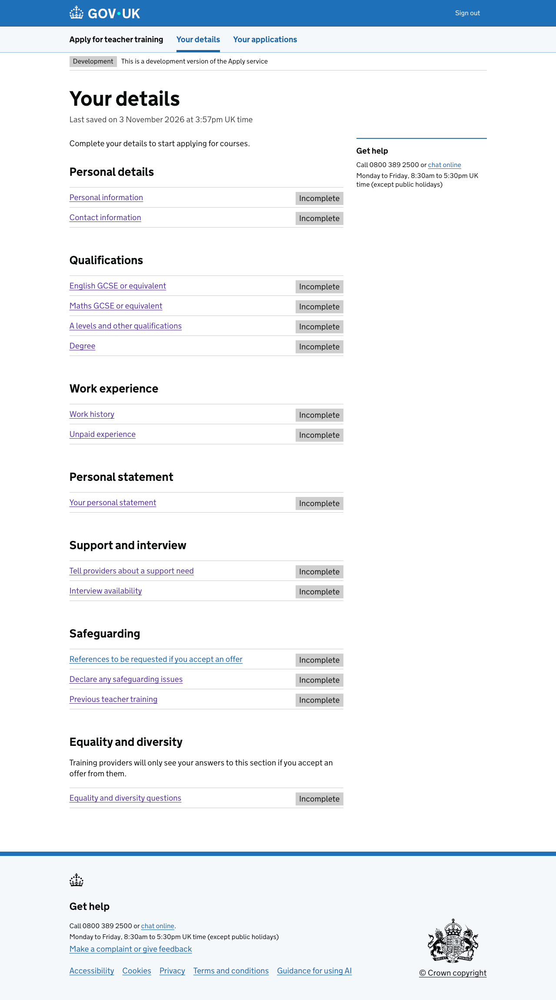
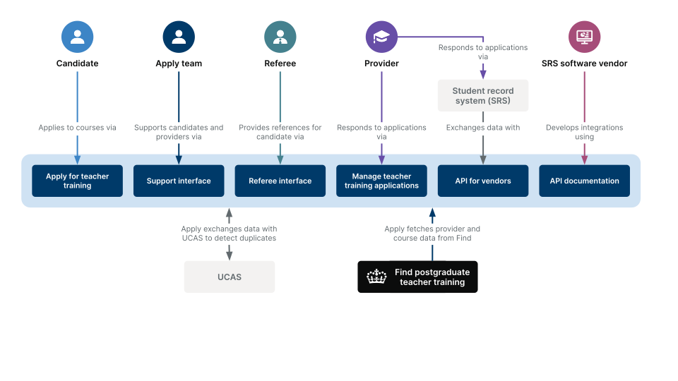
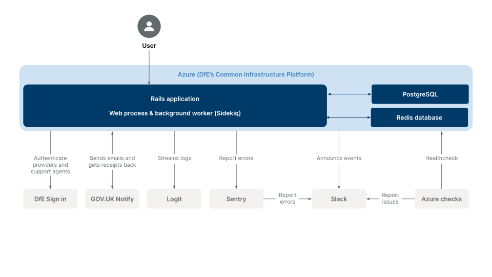
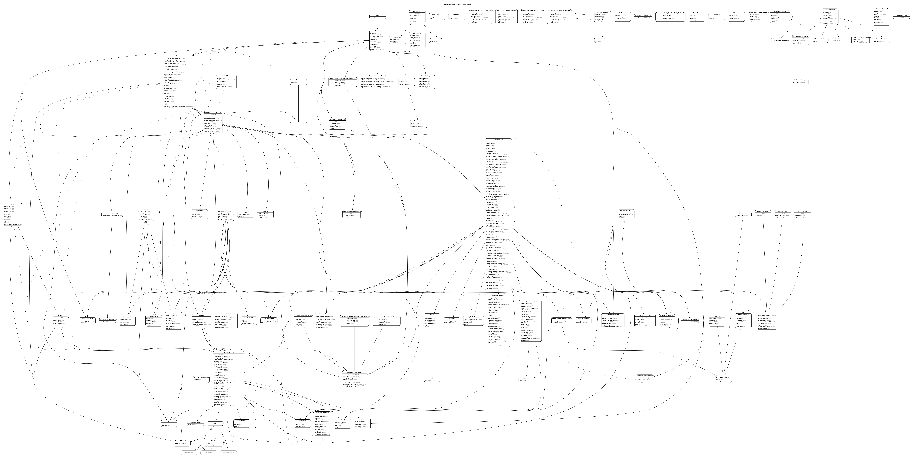

# Apply for teacher training

A service for candidates to [apply for teacher training](https://www.apply-for-teacher-training.service.gov.uk/candidate).

## Table of Contents

- [Live environments](#live-environments)
- [Guides](#guides)
- [Dependencies](#dependencies)
- [How the application works](#how-the-application-works)
  - [How Apply works with Find](#how-apply-works-with-find)
  - [Candidate interface - Apply](#candidate-interface---apply)
  - [Provider interface - Manage](#provider-interface---manage)
  - [Support interface](#support-interface)
  - [Reference interface](#reference-interface)
  - [APIs](#apis)
  - [Architecture](#architecture)
  - [Domain Model](#domain-model)
  - [Application states](#application-states)
- [Infrastructure validation workflow](#infrastructure-validation-workflow)
- [License](#license)

## Live environments

| Name       | URL                                                                  | Description                                                           | AKS namespace    |
| ---------- | -------------------------------------------------------------------- | --------------------------------------------------------------------- | ---------------- |
| Production | [www](https://www.apply-for-teacher-training.service.gov.uk)         | Public site                                                           | `bat-production` |
| Sandbox    | [sandbox](https://sandbox.apply-for-teacher-training.service.gov.uk) | Demo environment for software vendors who integrate with our API      | `bat-production` |
| Staging    | [staging](https://staging.apply-for-teacher-training.service.gov.uk) | For internal use by DfE to test deploys                               | `bat-staging`    |
| QA         | [qa](https://qa.apply-for-teacher-training.service.gov.uk)           | For internal use by DfE for testing. Automatically deployed from main | `bat-qa`         |

## Guides

- [General](docs/)
- [Development](docs/development/)
- [Infra](docs/infra/)

## Dependencies

### Production dependencies

| Dependency            | Version |
|-----------------------|---------|
| [Ruby](.ruby-version) | 4.0.9   |
| Node.js               | 24.18.1 |
| Yarn                  | 4.18.0  |
| PostgreSQL            | 17.11   |

### Development dependencies

See [Developer setup](docs/development/developer-setup.md)

## How the application works

The application has a number of different interfaces for different types of users.

### How Apply works with Find

Providers publish their teacher training courses through Find. Apply keeps its
provider and course information in sync with Find through the Teacher Training
Public API, including whether a course is available to candidates.

When a candidate chooses a course on Find and selects the option to apply, Find
links them to Apply with the provider and course details. Apply uses these
details to identify the course and continue the candidate into the application
journey. Candidates who are not signed in can create an account or sign in;
they then complete and submit their application through Apply. Find helps
candidates discover courses, while Apply handles the application itself.

### Candidate interface - Apply

#### User type

Individuals who are applying for teacher training.

#### Purpose

The candidate interface is the main public-facing interface for the service. It allows candidates to create an account, complete applications, and submit them to the relevant provider offering teacher training.

### Provider interface - Manage

#### User type

Individuals working for a provider who is offering teacher training.

#### Purpose

The provider interface allows providers to view applications submitted by candidates, and to make decisions on those applications.

### Support interface

#### User type

Individuals working for the DfE who are supporting candidates and providers.

#### Purpose

The support interface allows DfE staff to assist candidates and providers with their applications.

### Reference interface

#### User type

Individuals who have been requested by a candidate to provide a reference for their application.

#### Purpose

The reference interface allows referees to provide references for candidates who have requested them.

### APIs

This app provides several APIs for programmatic access to the Apply service. [Read about them here](docs/development/apply-apis.md).

### Architecture

We keep track of architecture decisions in [Architecture Decision Records (ADRs)](/adr).

### Domain Model

For simplicity the auditing table is not displayed in the diagram, as it is connected to most tables in the database.

Regenerate this diagram with `bundle exec rake erd`.

### Application states

[See detailed documentation here](docs/development/states.md)

## Infrastructure validation workflow

The scheduled workflow defined in `.github/workflows/validate-infra.yml` runs Terraform plan validations for the AKS cluster plus domains infrastructure/environment each day at **07:00 UTC** against **production** only. Failures and drift notifications are sent to the SD Infra alerts Teams channel via the `TEAMS_WEBHOOK_URL_INFRA` secret.

## License

[MIT Licence](LICENCE)
