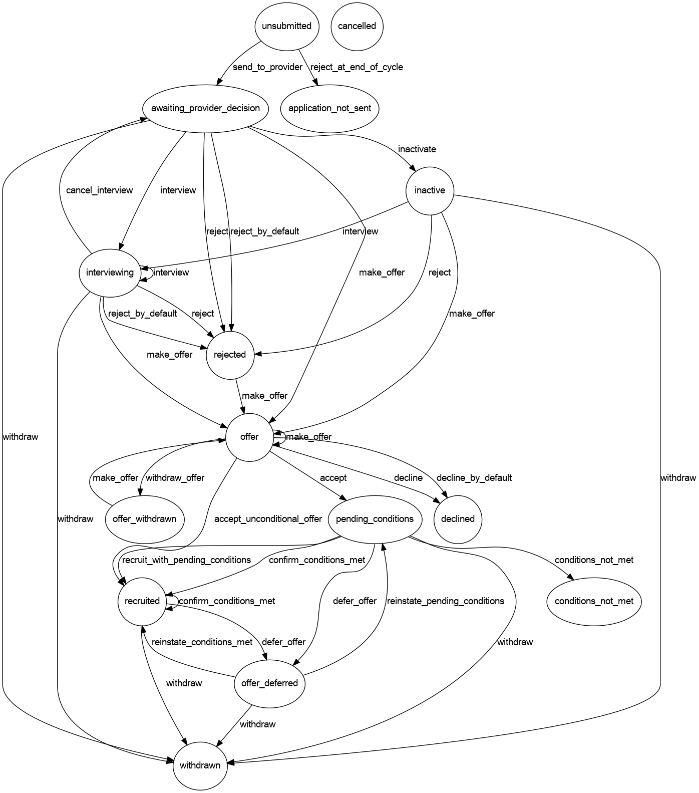

# Application States (#status)

`ApplicationChoice` uses a State Machine to manage the states the model can be in.

We use a library called [workflow](https://github.com/geekq/workflow) to manage this.

The workflow definition is stored in [ApplicationStateChange](https://github.com/DFE-Digital/apply-for-teacher-training/blob/main/app/services/application_state_change.rb).

## Current States

This is a table of all the states that an ApplicationChoice can have.

|State                         | Description|
|---                           | ---|
| `application_not_sent`       | Applications are set to this state at the end of the cycle if they are `unsubmitted` |
| `awaiting_provider_decision` | Submitted and waiting for provider decision |
| `cancelled`                  | DEPRECATED |
| `conditions_not_met`         | Submitted, accepted but offer conditions were not met by the candidate |
| `declined`                   | Offer by the provider is declined |
| `inactive`                   | Application has been in `awaiting_provider_decision` for more than 30 days |
| `interviewing`               | An interview is created by the provider for the candidate |
| `offer`                      | Application has received an offer from the provider |
| `offer_deferred`             | An offer has been deferred to next recruitement cycle |
| `offer_withdrawn`            | Provider withdraws an offer |
| `pending_conditions`         | Provider makes and offer and the candidate must meet conditions of the offer |
| `recruited`                  | Unconditional offer is accepted or offer conditions have been met |
| `rejected`                   | Application is rejected by provider accompanied by structured reasons|
| `unsubmitted`                | Candidate has added the course to their application form but has not submitted it yet |
| `withdrawn`                  | Submitted application has been withdrawn by the candidate (or by the provider on behalf of the canidate) |

## State Categories

These are groupings of states that allow us to define behaviour for a any application whose status is in the group.

See https://www.apply-for-teacher-training.service.gov.uk/support/docs/application-states.

| Category | States | Description |
|----------|--------|-------------|
| Active previous | awaiting_provider_decision inactive interviewing offer pending_conditions recruited | Applications in these states from the previous recruitment cycle are still considered active. |
| Carry over | cancelled rejected application_not_sent offer_withdrawn declined withdrawn conditions_not_met | Application in these states can be carried over to the next recruitment cycle. |
| Chase referee | pending_conditions recruited offer_deferred | Applications in these states are permitted to email referees regarding references for the candidate. |
| In progress | awaiting_provider_decision interviewing offer pending_conditions recruited offer_deferred | Applications in this state are considered to be ongoing, not yet completed, or require further action. |
| Interviewable | awaiting_provider_decision inactive interviewing | States in which an application can have an interview created for them. |
| Offer accepted | pending_conditions recruited conditions_not_met offer_deferred | The states that are possible once a provider has made an offer and the candidate has accepted. |
| Offered | offer pending_conditions recruited offer_withdrawn declined conditions_not_met offer_deferred | All states possible if a provider wants to offer a candidate a place. |
| Pending provider decision | awaiting_provider_decision interviewing | States in which the application is awaiting the provider to action/make a decision. |
| Post offered | pending_conditions recruited offer_withdrawn declined conditions_not_met offer_deferred | All states possible from the offer state. |
| Reapply | cancelled rejected offer_withdrawn declined withdrawn | If an pplication is in these states, the candidate can apply for the course again. |
| Successful | offer pending_conditions recruited offer_deferred | States in which the application has been successfully placed for teacher training. |
| Terminal | cancelled inactive recruited rejected application_not_sent offer_withdrawn declined withdrawn conditions_not_met | Used only in ApplicationMonitor (SupportInterface). |
| Unsuccessful | cancelled inactive rejected application_not_sent offer_withdrawn declined withdrawn conditions_not_met | States in which the application has not been successfully placed for teacher training. |
| Visible to provider | awaiting_provider_decision inactive interviewing offer pending_conditions recruited rejected offer_withdrawn declined withdrawn conditions_not_met offer_deferred | Applications is states what a provider can view. |

## Diagram

**Regenerate this diagram with `bundle exec rake generate_state_diagram`.**

